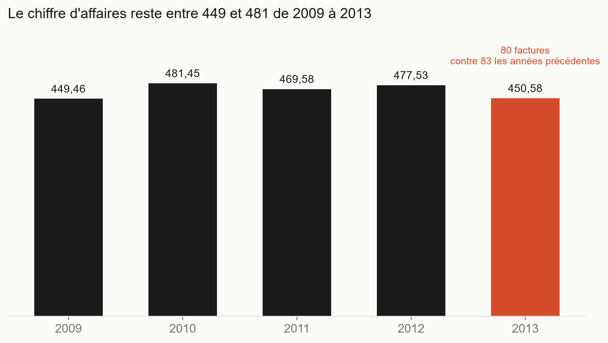
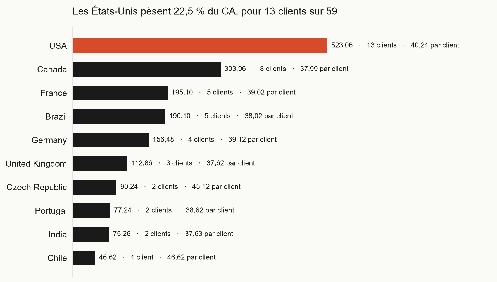
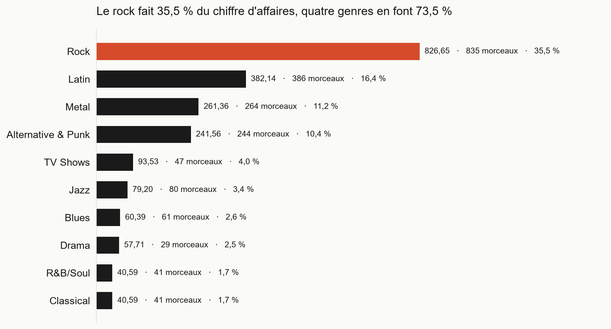
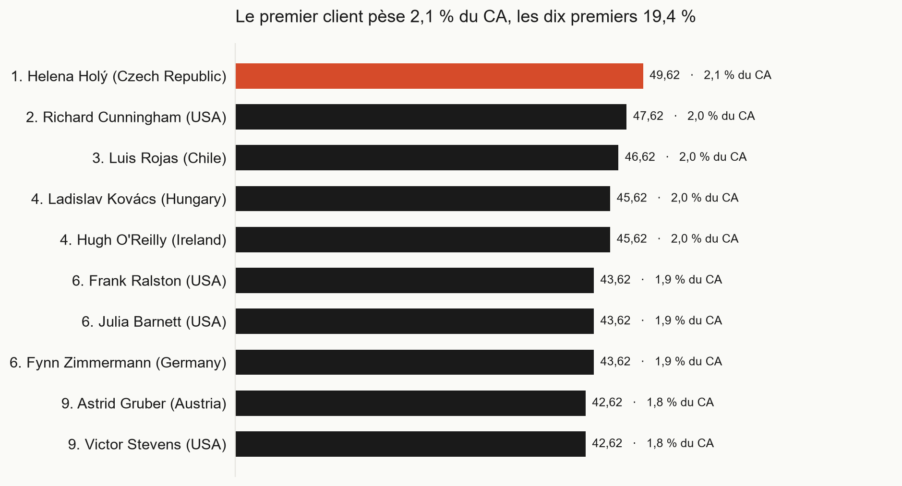
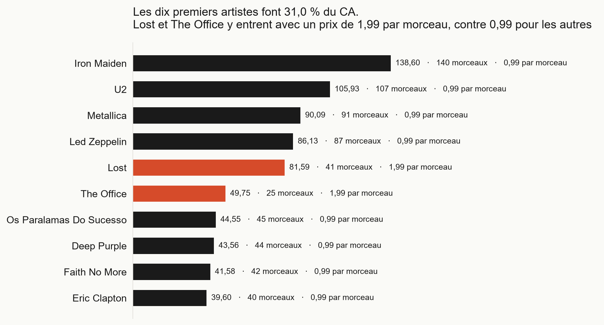
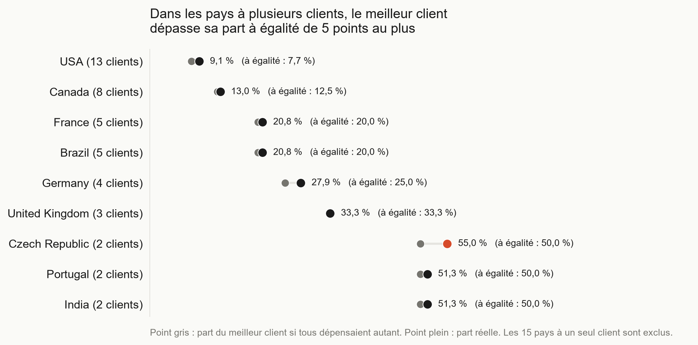

# Analyse des ventes Chinook : SQL et Python

Six questions de vente posées à la base Chinook, résolues en SQL (jointures, CTE, fonctions de fenêtre) puis présentées en graphiques avec pandas, Matplotlib et Seaborn.

## Contexte

Chinook est une base d'exemple qui simule une boutique de musique en ligne : clients, factures, morceaux, albums, artistes. Elle contient 59 clients dans 24 pays et 412 factures émises de 2009 à 2013, pour un chiffre d'affaires total de 2 328,60. La base ne précise pas la devise.

## Objectif

Répondre à six questions avec des requêtes SQL, puis montrer chaque réponse dans un graphique lisible :

1. Quel chiffre d'affaires par année ?
2. Quels pays rapportent le plus ?
3. Quels genres musicaux rapportent le plus ?
4. Qui sont les meilleurs clients, et le chiffre d'affaires dépend-il d'eux ?
5. Quels artistes génèrent le plus de ventes ?
6. Quel est le meilleur client de chaque pays ?

## Technologies

SQLite, SQL (jointures, CTE, fonctions de fenêtre), Python, pandas, Matplotlib, Seaborn, Jupyter.

## Méthode

- Une requête par question, dans un fichier du dossier `sql/`. `run_sql.py` les exécute dans le terminal, et le notebook lit les mêmes fichiers : aucune requête n'est recopiée.
- Les totaux sont contrôlés avant toute interprétation : la somme des lignes de facture et celle des factures valent toutes deux 2 328,60, et ce total reste identique après la chaîne de 4 jointures qui mène aux artistes (`sql/00_controle_lignes.sql`, `sql/05_controle_artistes.sql`).
- Les parts sont calculées avec une fonction de fenêtre sur tous les groupes, puis `LIMIT` ne garde que les 10 premières lignes : les pourcentages restent donc des parts du total.
- Dans les graphiques, les barres partent de 0, chaque titre énonce le constat, et l'orange marque un seul point par graphique.

## Résultats

### 1. Chiffre d'affaires par année



Le chiffre d'affaires reste entre 449,46 et 481,45 de 2009 à 2013 : 449,46 en 2009 et 450,58 en 2013, soit +0,2 % en cinq ans. Le nombre de factures est de 83 chaque année de 2009 à 2012, puis de 80 en 2013. L'orange marque cette baisse du nombre de factures, pas l'année au plus faible chiffre d'affaires (2009).

### 2. Chiffre d'affaires par pays



Les États-Unis réalisent 22,5 % du chiffre d'affaires (523,06) avec 13 clients sur 59, soit 22 % des clients. Leur avance vient du nombre de clients, pas d'une dépense plus élevée : le chiffre d'affaires par client est de 40,24 aux États-Unis, entre 37,62 et 39,12 dans les cinq pays suivants. Les dix premiers pays font 76,1 % du total. Le Chili (46,62 par client) et la République tchèque (45,12) sont en tête sur ce critère, avec 1 et 2 clients seulement : l'échantillon est trop petit pour conclure.

### 3. Chiffre d'affaires par genre



Le rock fait 35,5 % du chiffre d'affaires (826,65 pour 835 morceaux). Rock, Latin, Metal et Alternative & Punk réunis en font 73,5 %, et les dix premiers genres 89,4 % ; les 15 autres se partagent 10,6 %. Le prix unitaire est de 1,99 pour TV Shows et Drama, contre 0,99 pour le rock : une ligne de ces genres compte double dans le chiffre d'affaires.

### 4. Meilleurs clients



Le chiffre d'affaires ne dépend pas de quelques gros clients : les dix premiers représentent 19,4 % du total et le premier 2,1 % (49,62). Tous ont passé 7 commandes, l'écart vient du montant de chaque commande. Les ex æquo sont nombreux (rangs 4, 6 et 9) et le top 10 est coupé au milieu d'une égalité : la liste n'est pas définitive.

### 5. Artistes



Les dix premiers artistes représentent 31,0 % du chiffre d'affaires, Iron Maiden en tête avec 6,0 % (140 morceaux vendus). Lost et The Office entrent dans le top 10 avec 41 et 25 morceaux, parce que leur prix unitaire est de 1,99 contre 0,99 pour les autres. Le classement dépend donc de la mesure choisie : en nombre de morceaux, The Office n'y figurerait probablement pas.

### 6. Meilleur client de chaque pays



Quinze des 24 pays n'ont qu'un seul client, qui est donc le « meilleur » par défaut. Dans les neuf pays à plusieurs clients, le meilleur client dépasse sa part à égalité de 5 points au plus : 9,1 % aux États-Unis (13 clients) contre 7,7 % à égalité, 55,0 % en République tchèque (2 clients) contre 50,0 %. Au Royaume-Uni, les trois clients ont le même montant (37,62) et le choix du premier est arbitraire.

La requête de cette question, qui classe les clients à l'intérieur de chaque pays :

```sql
WITH ca_client AS (
    SELECT c.CustomerId,
           c.FirstName || ' ' || c.LastName AS client,
           c.Country                        AS pays,
           ROUND(SUM(i.Total), 2)           AS chiffre_affaires
    FROM Customer AS c
    JOIN Invoice  AS i ON i.CustomerId = c.CustomerId
    GROUP BY c.CustomerId, c.FirstName, c.LastName, c.Country
),
classement AS (
    SELECT pays, client, chiffre_affaires,
           ROW_NUMBER() OVER (PARTITION BY pays
                              ORDER BY chiffre_affaires DESC, CustomerId) AS rang_pays,
           COUNT(*) OVER (PARTITION BY pays) AS nb_clients_pays,
           ROUND(100.0 * chiffre_affaires
                 / SUM(chiffre_affaires) OVER (PARTITION BY pays), 1) AS part_du_pays_pct
    FROM ca_client
)
SELECT pays, client, chiffre_affaires, nb_clients_pays, part_du_pays_pct
FROM classement
WHERE rang_pays = 1
ORDER BY chiffre_affaires DESC, pays;
```

## Notions SQL utilisées

| Notion | Où |
|---|---|
| `JOIN ... ON`, jusqu'à 4 jointures | requêtes 2 à 6 |
| `GROUP BY` avec `SUM`, `COUNT` | toutes |
| `SUM(...) OVER ()` : part du total | requêtes 2 à 5 |
| `WITH` (CTE) : calcul en deux étapes | requêtes 4 et 6 |
| `RANK()` : rang avec ex æquo | requête 4 |
| Somme cumulée `ROWS BETWEEN UNBOUNDED PRECEDING AND CURRENT ROW` | requête 4 |
| `ROW_NUMBER() OVER (PARTITION BY ...)` : classement par groupe | requête 6 |
| `CustomerId` en second critère de tri pour départager les ex æquo | requêtes 4 et 6 |

## Limites

- La devise n'est pas indiquée : les montants sont exprimés dans l'unité de la base.
- Le prix unitaire de 1,99 (TV Shows, Drama, Lost, The Office) fausse les classements en chiffre d'affaires : un morceau à 1,99 pèse deux fois un morceau à 0,99.
- Base d'exemple : 5 années, 59 clients, 412 factures. Les écarts entre pays ou entre clients portent sur de petits effectifs.
- Pour la question 6, quand plusieurs clients ont le même montant, un seul est retenu, par ordre d'identifiant.

## Reproduire l'analyse

```powershell
git clone https://github.com/iitsh/sql-python-chinook.git
cd sql-python-chinook
python -m venv .venv
.venv\Scripts\Activate.ps1
pip install -r requirements.txt

python run_sql.py sql/04_meilleurs_clients.sql
jupyter lab
```

Ouvre ensuite `notebooks/analyse_ventes.ipynb` et lance toutes les cellules.

## Contenu du dépôt

```text
data/        base Chinook_Sqlite.sqlite
sql/         requêtes numérotées (00 à 07) : contrôles et six questions
notebooks/   analyse_ventes.ipynb : lecture des requêtes et graphiques
docs/        graphiques exportés (PNG)
run_sql.py   exécute un fichier .sql et affiche le résultat
check_db.py  vérifie la base et son total
```

Source des données : [chinook-database](https://github.com/lerocha/chinook-database) (fichier `Chinook_Sqlite.sqlite`).

## Auteur

Rayane Berrada · [GitHub](https://github.com/iitsh) · Autre projet : [Turnover RH avec Power BI](https://github.com/iitsh/powerbi-hr-attrition)